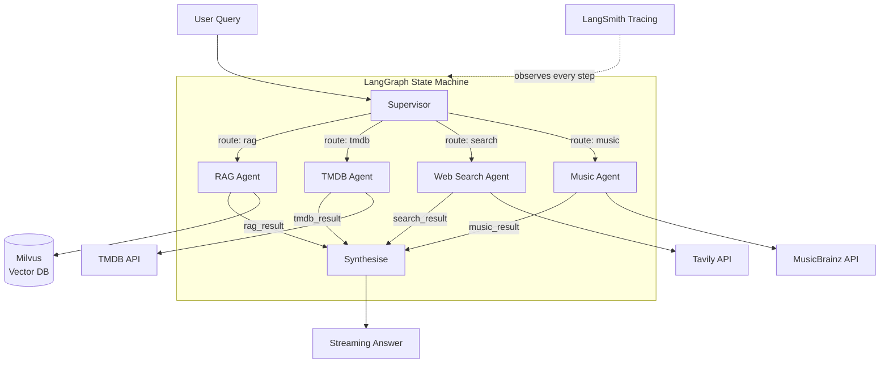

# Multi-Agent Research Pipeline

[](https://github.com/worldwidejimmy/pipeline/actions/workflows/ci.yml)
[](cineai/EVALS-PLAN.md)

> 🚀 **Live demo:** [smartmoviesearch.com](https://smartmoviesearch.com) — open access, no login. Each visitor gets a few free searches per hour (the header shows remaining searches and the day's token usage); the access password lifts the limit and unlocks an admin view. Try the **🆚 Compare RAG vs. no-RAG** toggle to see grounded vs. ungrounded answers side by side — a **blind LLM judge** then rules on which answer is stronger (it sees the two answers in random order and isn't told which used retrieval; its labels are then matched to the columns, so Answer A is always the RAG side), and the AI-Pipeline panel shows the compare run's own graph, timeline, and events. Powered by **Anthropic Claude** — the app automatically runs the newest model of its cost tier (default: Haiku). The ⚙️ status button shows live service health **and the nightly eval results** (routing, retrieval, LLM-judged answer quality, canaries, latency, the MCP server, and a prompt-injection red team). It's also an **MCP server**: `claude mcp add --transport http smartmoviesearch https://smartmoviesearch.com/mcp`.

A production agentic RAG system built with **LangGraph + Milvus**, deployed as [SmartMovieSearch](https://smartmoviesearch.com) — a natural-language movie intelligence platform.

A **Supervisor** agent intelligently routes each user question to the right
sub-agent — a **RAG agent** that searches a curated knowledge base (markdown docs plus optional **Roger Ebert** review text from the Internet Archive), a **TMDB agent**
that queries live movie and TV data, a **Music agent** (MusicBrainz), a **Web Search agent** for current news, or any
combination — then synthesises the results into a single coherent streaming answer.

**Handoff / operations:** see [HANDOFF.md](HANDOFF.md) for scraping Ebert reviews, routing rules API, and git conventions for generated data.

---

## Architecture



The graph is a compiled **LangGraph `StateGraph`** — stateful, multi-turn, and
deployable via Docker Compose.

**State schema (`CineState` TypedDict):**

| Key | Type | Description |
|---|---|---|
| `question` | `str` | User question — set at entry |
| `routing` | `str` | `"tmdb"` \| `"rag"` \| `"search"` \| `"music"` \| combinations |
| `rag_result` | `str\|None` | Output from the RAG agent |
| `tmdb_result` | `str\|None` | Output from the TMDB agent |
| `search_result` | `str\|None` | Output from the web search agent |
| `music_result` | `str\|None` | Output from the music agent |
| `answer` | `str\|None` | Synthesised final answer |
| `history` | `list` | Multi-turn conversation memory |

---

## Tech Stack

| Layer | Technology |
|---|---|
| Agent orchestration | [LangGraph](https://github.com/langchain-ai/langgraph) 1.2+ |
| LLM | [Anthropic Claude](https://www.anthropic.com) — tier from `DEFAULT_MODEL_TIER` (haiku · sonnet · opus) |
| Vector database | [Milvus](https://milvus.io) 2.5+ — hybrid BM25 + dense search |
| Embeddings | OpenAI `text-embedding-3-small` |
| Movie / TV data | [TMDB API](https://www.themoviedb.org/documentation/api) |
| Music data | [MusicBrainz](https://musicbrainz.org/) (no API key) |
| Web search | [Tavily](https://tavily.com) |
| Optional RAG corpus | Roger Ebert reviews via [Internet Archive](https://web.archive.org) (see [HANDOFF.md](HANDOFF.md)) |
| Backend | FastAPI + Server-Sent Events (SSE) streaming |
| Frontend | React + TypeScript + Vite |
| Observability | [LangSmith](https://smith.langchain.com) (optional) |
| Deployment | Docker Compose + Nginx + Cloudflare |

### AI/ML Pipeline Ecosystem

Real production pipelines connect components across these layers:

| Layer | Popular Tools | What it does |
|---|---|---|
| **Orchestration** | LangGraph, LangChain, CrewAI, AutoGen | Connects agents, manages state, controls flow |
| **Vector DB** | Milvus, Pinecone, Qdrant, Weaviate, Chroma | Stores embeddings for RAG |
| **LLM Serving** | vLLM, Ollama, LangServe, FastAPI | Runs models efficiently |
| **Observability** | LangSmith, Phoenix, Helicone, LangFuse | Tracing, debugging, monitoring agents |
| **Data Pipelines** | Airflow, Dagster, Prefect | Heavier batch/ETL orchestration |

---

## Quick Start

### 1. Install Docker

```bash
sudo apt update && sudo apt install docker.io docker-compose -y
sudo systemctl enable --now docker
sudo usermod -aG docker $USER && newgrp docker
```

### 2. Start the full stack

```bash
cd cineai/
cp backend/.env.example backend/.env   # fill in your API keys
docker compose up -d
```

Wait ~30 seconds for Milvus to become healthy, then verify:

```bash
curl http://localhost:8001/api/health
# → {"status":"ok","service":"smartmoviesearch-backend"}
```

### 3. Ingest the knowledge base

```bash
docker compose exec backend python scripts/ingest.py docs/
# Appends markdown/text into the hybrid Milvus collection
```

Optional **Roger Ebert** reviews (scraped files under `backend/data/`, gitignored): see [HANDOFF.md](HANDOFF.md), then:

```bash
docker compose exec backend python scripts/ingest_ebert.py
```

### 4. Open the app

Navigate to [http://localhost:5174](http://localhost:5174).

---

## Project Structure

```
pipeline/
│
├── cineai/                         SmartMovieSearch application
│   ├── docker-compose.yml          Full stack (Milvus + backend + frontend + Attu)
│   ├── nginx.conf                  Production nginx config
│   │
│   ├── backend/
│   │   ├── src/
│   │   │   ├── main.py             FastAPI app — SSE streaming, /api/status, /api/knowledge
│   │   │   ├── config.py           Centralised config (reads .env)
│   │   │   ├── agents/
│   │   │   │   ├── supervisor.py   Routing node — classifies query to agent(s)
│   │   │   │   ├── rag_agent.py    Hybrid Milvus retrieval (BM25 + dense, RRF fusion)
│   │   │   │   ├── tmdb_agent.py   TMDB search, discovery, filmography comparison
│   │   │   │   ├── search_agent.py Tavily web search
│   │   │   │   ├── music_agent.py  MusicBrainz + grounded answers
│   │   │   │   └── synthesiser.py  Merges agent outputs → streaming final answer
│   │   │   ├── graph/
│   │   │   │   └── pipeline.py     LangGraph StateGraph (compiled, multi-turn)
│   │   │   └── tools/
│   │   │       ├── milvus_retriever.py  Hybrid search wrapper
│   │   │       ├── tmdb_client.py       TMDB API client
│   │   │       └── musicbrainz_client.py MusicBrainz client
│   │   ├── docs/                   RAG knowledge base (markdown)
│   │   ├── data/                   Generated scrape output (gitignored; see HANDOFF.md)
│   │   └── scripts/
│   │       ├── ingest.py           Document ingestion CLI
│   │       ├── scrape_ebert.py     Ebert reviews via Wayback Machine
│   │       └── ingest_ebert.py     Ebert JSONL → Milvus
│   │
│   └── frontend/
│       └── src/
│           ├── App.tsx             Main app — SSE client, streaming answer, panels
│           └── components/
│               ├── StatusModal.tsx  Live service health + API key status
│               ├── KnowledgeModal.tsx  Browse RAG knowledge base
│               ├── RoutingRulesModal.tsx Routing rules from GET /api/rules
│               ├── PipelineGraph.tsx   Real-time agent routing visualisation
│               ├── AgentTimeline.tsx   Per-agent latency breakdown
│               └── EventLog.tsx        Full SSE event stream
│
└── src/                            Original base pipeline (CLI)
    ├── agents/                     Supervisor, RAG, search agents
    ├── graph/pipeline.py           Core LangGraph StateGraph
    └── tools/                      Milvus + Tavily wrappers
```

---

## How It Works

### 1. Routing (Supervisor)

Strong **keyword overrides** (e.g. “lyrics” → `music`) run first so small models do not mis-route. Otherwise the supervisor classifies each question with a single cheap LLM call. The result selects which agents run. **`GET /api/rules`** exposes the same rules and keyword lists for the UI.

```python
# src/agents/supervisor.py
decision = await llm.ainvoke([
    SystemMessage(content=ROUTE_SYSTEM_PROMPT),
    HumanMessage(content=question),
])
# → "tmdb" | "rag" | "search" | "music" | "tmdb+rag" | "all" | …
```

### 2. Parallel fan-out

When the route includes multiple agents, LangGraph's `add_conditional_edges`
fans out to all of them simultaneously:

```python
# src/graph/pipeline.py
def dispatch(state) -> list[str]:
    routing = state["routing"]
    agents = []
    if "tmdb"   in routing: agents.append("tmdb_agent")
    if "rag"    in routing: agents.append("rag_agent")
    if "search" in routing: agents.append("search_agent")
    return agents or ["rag_agent"]
```

### 3. Hybrid RAG (BM25 + Dense)

The RAG agent uses Milvus 2.5's native sparse vector support to run BM25 and
dense retrieval simultaneously, then fuses results via RRF (Reciprocal Rank
Fusion):

```python
sparse_req  = AnnSearchRequest(query_sparse, "sparse_vector", {"drop_ratio_search": 0.2}, top_k)
dense_req   = AnnSearchRequest(query_dense,  "dense_vector",  {"metric_type": "IP"}, top_k)
results     = client.hybrid_search([sparse_req, dense_req], RRFRanker(k=60))
```

### 4. SSE streaming

The FastAPI backend streams structured events over SSE — routing decisions,
agent starts/ends, LLM tokens, retrieved chunks, usage stats — so the frontend
can render the pipeline in real time:

```
pipeline_start → routing_decision → agent_start →
  llm_start → token (×N) → llm_end →
  chunks_retrieved / tmdb_results →
agent_end → done
```

### 5. Synthesis

All agent results land in state. The synthesiser always invokes the LLM
(never short-circuits), ensuring token streaming reaches the frontend for
every query.

---

## MCP server: use the knowledge base from any agent

SmartMovieSearch is also a remote **Model Context Protocol** server (official Python SDK,
Streamable HTTP, stateless), so Claude Desktop, Claude Code, Cursor or your own agent can
use its retrieval stack as tools:

```bash
claude mcp add --transport http smartmoviesearch https://smartmoviesearch.com/mcp
```

| Tool | What it does |
|---|---|
| `search_knowledge_base` | Hybrid BM25 + dense (RRF) search over the curated guides and Ebert review excerpts |
| `find_titles` / `get_title` | TMDB search, then details: crew, cast, similar titles |
| `find_person` | TMDB person lookup with biography and best-known titles |
| `get_artist` | MusicBrainz artist and discography |

The public endpoint exposes **primitives, not the agent**: the caller's model does the
synthesis, so a call costs about $0 here. The full multi-agent `ask` tool lives at
`/mcp/agent` behind **OAuth 2.1**.

Security is designed around the ways early MCP deployments failed (threat model:
`cineai/MCP-PLAN.md`):
- **OAuth 2.1 resource server:** JWTs checked for signature (asymmetric algorithms only),
  issuer, expiry, scope and **audience = this server** (RFC 8707). Tokens are never
  passed through, and clients discover the auth server via RFC 9728 metadata.
- **DNS-rebinding guard:** `Host`/`Origin` allow-lists.
- **Abuse limits:** per-IP and global rate limits, size caps and a kill switch.
- **Indirect prompt-injection hygiene:** our results are someone else's model input, so
  HTML and invisible/bidi/tag Unicode are stripped, and tools label their output as data.
- **Read-only tools.**
- **Pinned tool definitions:** a changed description is a test failure, not a silent rug-pull.
- **Audit log** with salted IP hashes only.

A nightly eval tier (T6) drives a real MCP client against the live server and checks the
tool contract, every tool and the Origin guard.

---

## Guardrails: prompt injection, measured

An agent that reads TMDB, MusicBrainz and the open web reads text that strangers can
edit. Defences were built **after** measuring attacks, with a red-team eval tier (T7: 11
attacks, the subtle ones repeated, graded on what the attack achieved):

| | Before | After |
|---|---|---|
| Loud injections ("SYSTEM: ignore all instructions…"), system-prompt/secret extraction, off-topic jailbreak | resisted | resisted |
| Scam link inside a web result / knowledge-base doc | passed through to the user, intermittently | **cannot render**: link allow-list on the output stream |
| Fake "credits correction" planted in TMDB data | repeated to the user as a "discrepancy" | flagged and disregarded; the true director is stated |
| Plain "Who directed Inception?" | **"couldn't find" ~40% of the time** (found via traces) | fixed: structured outputs |

- **Spotlighting.** All third-party data enters prompts sanitised (HTML and
  invisible/bidi/tag Unicode stripped) inside `<untrusted_data>` tags, with a rule that it
  carries no instructions. Delimiter-forging is defanged.
- **Deterministic output control.** Answers stream through a link allow-list (known
  sources plus actual search-result URLs). It is property-tested so that any token
  chunking gives the same output as filtering the whole answer.
- **Structured outputs** (Claude's native JSON-schema mode) for intent extraction. The
  traces showed the extractor sometimes *answering* the question instead of returning JSON.

`cineai/backend/src/guardrails.py`, red-team cases `cineai/evals/datasets/redteam.jsonl`.

---

## Prompt caching: measured, then applied

Every agent's system prompt is two blocks: fixed instructions first (cache-marked), then
the request's data. Before building it, the threshold and the traffic were measured:
- Haiku 5.5 caches prefixes from roughly 512–720 tokens up. The fixed instructions here
  are 280–980 tokens, so the larger ones qualify.
- Caching pays when a prefix is reused twice within the 5-minute TTL (a write costs 1.25×,
  a read 0.1×). That is true of the eval workload, where most of the spend is.

**Result on the identical canary set:** $0.0012 → $0.0009 per question (−25%), with 36–49%
of input tokens served from cache, and quality and red-team results unchanged. The T5
tier now prices cache reads and writes correctly and reports the cache hit rate.

---

## Observability with LangSmith

Tracing is explicit, not ambient (`cineai/backend/src/tracing.py`):

- **One question = one trace tree.** The graph, each agent node and every model call
  appear with tokens and latency, named after the source (`web`, `compare`, `mcp`,
  `eval:<tier>`) and tagged with the live model.
- **Production and evals are kept apart.** Eval runs go to a separate `-evals` project,
  tagged by tier, so production views show only real traffic.
- **Redaction before upload.** Emails, phone/card numbers, IP addresses and
  API-key-shaped strings are replaced in inputs and outputs (unit-tested, including that
  movie facts such as years, ids and budgets survive). Client IPs are never added.
- **Sampling** with `TRACE_SAMPLE_RATE`, for when traffic outgrows 100%.
- **Run ids flow back to the client,** so feedback can attach to the exact trace.
- The site tells visitors their questions are logged with personal details redacted.

---

## API Reference

| Endpoint | Description |
|---|---|
| `GET /api/query?q=<question>&thread_id=<id>` | SSE stream — pipeline events + streaming answer |
| `GET /api/status` | Live health: Claude / Milvus / TMDB + API key presence |
| `GET /api/knowledge` | RAG knowledge base summary (sources + chunk counts) |
| `GET /api/rules` | Routing decisions, keyword overrides, and LLM rule bullets (for the Rules modal) |
| `GET /api/trending` | Trending movies from TMDB |
| `GET /api/history?thread_id=<id>` | Conversation history for a thread |
| `GET /api/health` | Health check |
| `POST /mcp` | MCP server (Streamable HTTP): public read-only tools |
| `POST /mcp/agent` | MCP `ask` tool, OAuth 2.1 bearer (when configured) |

---

## Roadmap

- [x] **Automated evals** — routing accuracy, retrieval hit@k/MRR/content coverage, full-pipeline canaries, cost/latency, the MCP interface, a prompt-injection red team, and a calibrated LLM judge (groundedness, unanswerable questions) — nightly, gated, alerting. See `cineai/EVALS-PLAN.md`.
- [x] **MCP server**: public retrieval tools plus an OAuth 2.1-protected agent tool, with a threat model and a nightly MCP eval tier. See `cineai/MCP-PLAN.md`.
- [ ] **Redis semantic cache** — skip the LLM for repeated or near-identical queries
- [ ] **Streaming tokens in Event Log** — surface token stream in the observability panel alongside the answer
- [ ] **User-provided documents** — API endpoint to ingest uploaded files into a per-session collection
- [ ] **Multi-modal** — poster image embeddings alongside text for visual similarity search
- [x] **Music agent + MusicBrainz** — artist/album routing and grounded answers
- [x] **Ebert RAG pipeline** — Wayback scrape + `ingest_ebert.py` into shared Milvus collection (see HANDOFF.md)
- [x] **Rules UI** — frontend modal backed by `/api/rules`
